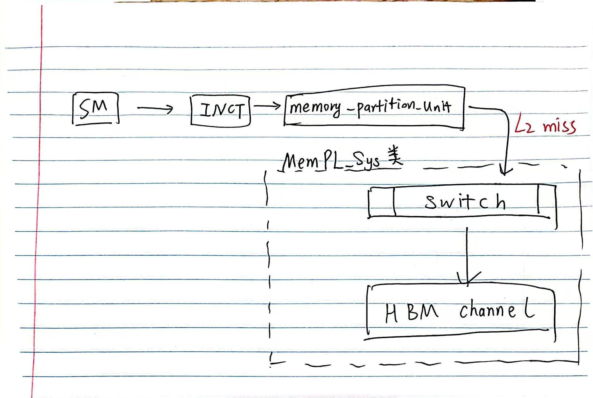
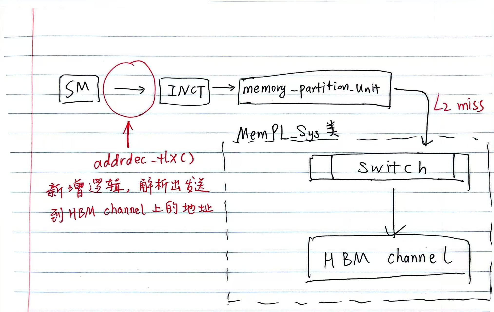

# 改动计划

## 声明
代码仓库为https://github.com/z11s11y11/FlashGPU_Sim_Baseline.git，相关的代码引用都是基于这个仓库的。

## 访存路径
访存的路径是从SM发送一个访存事务，然后再到片上网络，再到L2缓存，之后到dram，如图所示
其中代码转换发生在SM到INCT的过程之中，如图所示,详情见[代码转换.c](./code/代码转换.c)

## 需要新增的类
需要新增MemPL_SysConfig类，用于配置内存系统的参数，如GPU数量，HBM通道、带宽，延迟，时钟频率等。详见[MemPL_SysConfig.c](./code/MemPL_SysConfig.c)

需要新增MemPL_Sys类，用于创建和管理dram_t向量。详见[MemPL_Sys.c](./code/MemPL_Sys.c)